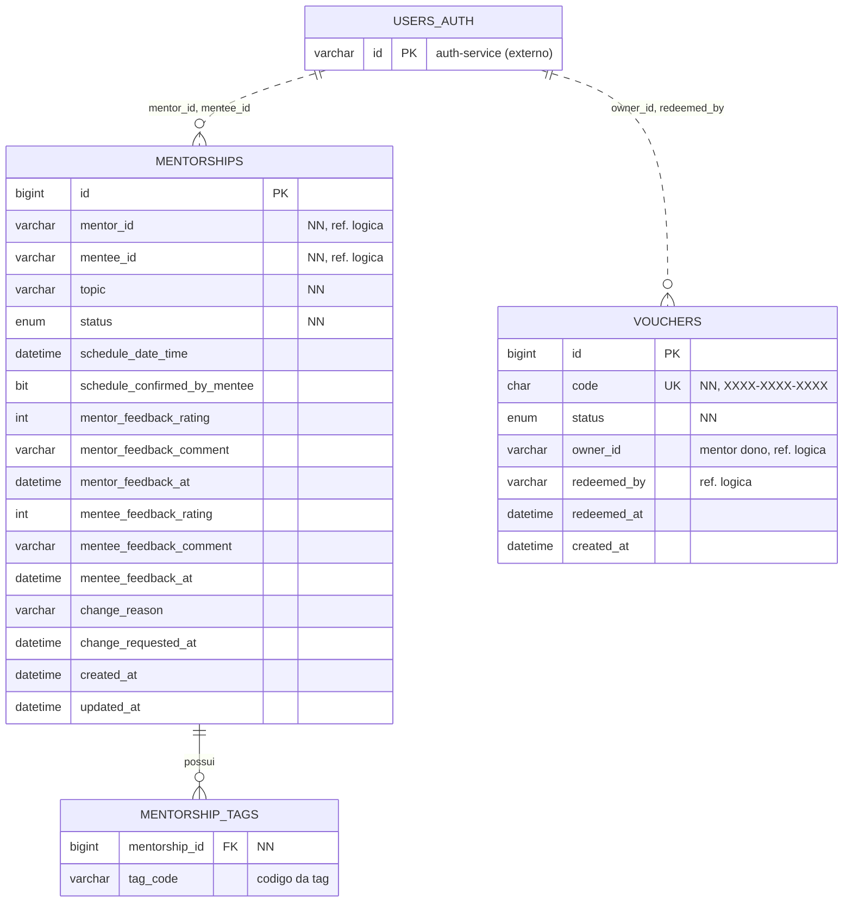

# DER - mentorship-service

Banco: MySQL 8.4 (schema `mentorship`). Cada microsserviço tem o seu próprio banco, então
**não existem chaves estrangeiras para tabelas de outros serviços**. Os campos marcados como
"ref. lógica" guardam o id de um usuário do auth-service, sem constraint no banco.

Linha tracejada = referência lógica entre serviços (sem FK). Linha contínua = FK real.

## Dicionário de dados

### mentorships

| Coluna | Tipo | Regra |
|---|---|---|
| id | BIGINT, PK, auto_increment | |
| mentor_id | VARCHAR(64) | NOT NULL. Id do mentor (auth-service). Definido pelo matchmaking |
| mentee_id | VARCHAR(64) | NOT NULL. Id do mentorado, vindo do `sub` do JWT |
| topic | VARCHAR(255) | NOT NULL |
| status | ENUM | NOT NULL: PENDING, SCHEDULED, CONFIRMED, COMPLETED, CHANGE_REQUESTED, CANCELLED |
| schedule_date_time | DATETIME(6) | Preenchido quando o mentor agenda |
| schedule_confirmed_by_mentee | BIT | Confirmação do mentorado |
| mentor_feedback_* | rating, comment, at | Feedback do mentor (embutido) |
| mentee_feedback_* | rating, comment, at | Avaliação do mentorado (embutido) |
| change_reason, change_requested_at | VARCHAR(1000), DATETIME(6) | Pedido de troca de mentor |
| created_at, updated_at | DATETIME(6) | Preenchidos pelo JPA Auditing |

### mentorship_tags

| Coluna | Tipo | Regra |
|---|---|---|
| mentorship_id | BIGINT | FK para mentorships(id), NOT NULL |
| tag_code | VARCHAR(100) | **Código** da tag (campo "codigo" do admin/profile), enviado ao matchmaking |

### vouchers

| Coluna | Tipo | Regra |
|---|---|---|
| id | BIGINT, PK, auto_increment | |
| code | CHAR(14) | NOT NULL, UNIQUE. Formato fixo XXXX-XXXX-XXXX (letras e números, 14 caracteres com hifens) |
| status | ENUM | NOT NULL: AVAILABLE, REDEEMED |
| owner_id | VARCHAR(64) | Mentor a quem o admin liberou o voucher; é ele quem repassa o código ao mentorado |
| redeemed_by | VARCHAR(64) | Id de quem resgatou |
| redeemed_at | DATETIME(6) | |
| created_at | DATETIME(6) | |

## Decisões de modelagem

1. **Feedback, agendamento e pedido de troca ficam dentro de `mentorships`** (colunas, não tabelas).
   Cada mentoria tem no máximo um de cada, e eles sempre são lidos junto com a mentoria. Se um dia
   uma mentoria puder ter vários feedbacks, esses grupos viram tabelas próprias.
2. **`mentorship_tags` é uma tabela à parte** porque uma mentoria tem várias tags (1:N).
3. **Sem FK entre `vouchers` e `mentorships`.** Pela regra do professor, o voucher só serve para o
   usuário entrar como mentorado; a mentoria não consulta nem consome voucher.
4. **Resgate atômico:** `UPDATE vouchers ... WHERE code = ? AND status = 'AVAILABLE'` garante que
   um código só seja resgatado uma vez, mesmo com requisições simultâneas.

## Fluxo do voucher (regra do professor)

1. O mentor solicita um voucher ao admin.
2. O admin libera o voucher para o mentor (`owner_id` = id do mentor).
3. O mentor compartilha o código com o mentorado.
4. O mentorado resgata o código (`redeemed_by`, `redeemed_at`) e entra no universo de mentorados.
5. Depois do resgate, o voucher não é mais usado em nenhuma outra regra.

## Pontos em aberto

- **Tag:** guardamos o **código** da tag (no banco da Equipe B a coluna é `CODIGO`). Confirmar o nome do campo no JSON e o tamanho do valor.
- Tipo dos ids de usuário (`mentor_id`, `mentee_id`, `redeemed_by`, `owner_id`): hoje `VARCHAR(64)`. Confirmar com a Equipe B.
- Como o mentor "solicita" o voucher (endpoint no admin-service ou fora do sistema) e como ele consulta os que recebeu.
